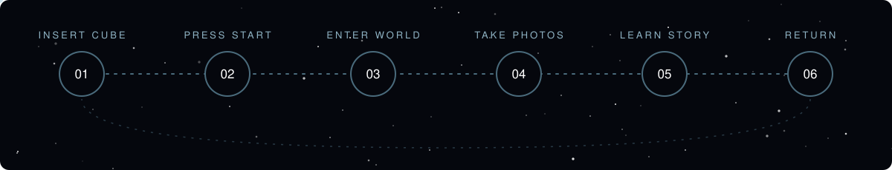

  

<table align="center">
  <tr>
    <td align="center"> CANDY WORLD</td>
    <td align="center"> ARCHIVE ROOM</td>
    <td align="center"> ABANDONED CITY</td>
  </tr>
</table>

  
  
  
  

<i>Boot up a cube. Photograph a world. Uncover its story.</i>

 

You wake in an archive room aboard a stranded ship, **Space Date 5904 (3,400,203 AD)**. Its machines are built in the style of the early 2000s. Its shelves are lined with glowing cubes, each holding a memory from a distant time.

You don't remember how you got here, or where everyone else has gone.

Once inside a memory, you take photographs of what you find. After each photo, the Archiver tells you a little about the world you just captured. When you're done, you return to the archive and choose another cube.

 

 

1. **Insert a cube.** Grab a memory from the shelf and slot it into the console.
2. **Press START.** Wait for the memory to load.
3. **Enter the world.** Step inside a place that once existed.
4. **Take photos.** Three shots, each ejecting as a developing polaroid.
5. **Learn the story.** Every photo unlocks a piece of what happened there.
6. **Return.** Pull the cube to disconnect and head back to the archive.

 

&nbsp;✦ View all archived memories (20)

 

| # | Memory | Status |
|---|---|---|
| 01 | Cyberpunk City | Completed |
| 02 | Beach | Planned |
| 03 | Snowy Mountains | Planned |
| 04 | Vaporwave Zone | Planned |
| 05 | Solarpunk City | Planned |
| 06 | Mars Colony | Planned |
| 07 | Abandoned Moss City | Planned |
| 08 | Glitch World | Planned |
| 09 | Cat Street | Planned |
| 10 | Candy World | Planned |
| 11 | Summer | Planned |
| 12 | Fall | Planned |
| 13 | Spring | Planned |
| 14 | Winter | Planned |
| 15 | Rainy Park | Planned |
| 16 | Boat on lake | Planned |
| 17 | Flower Field  | Planned |
| 18 | Picnic | Planned |
| 19 | Abandoned Mall | Planned |
| 20 | Graveyard | Planned |

MORE TO COME...

 

**Unity** with XR Interaction Toolkit · **Blender** for low-poly models · **BandLab** for music · **Adobe Illustrator** for posters · tested on **Meta Quest** via Quest Link

 

  

